<!-- Alternative: full, uncut panel images, one link per full panel. The linkable detailed menu is available in the text navigation below. -->

<a href="https://github.com/4tRitch" title="4tRitch — hero">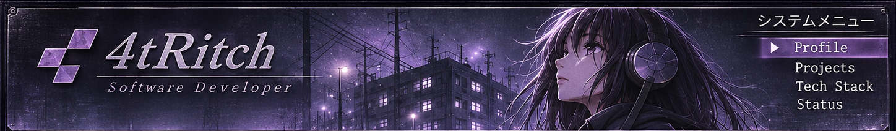</a> 
<a href="#projects" title="Main menu — navigation via text links below">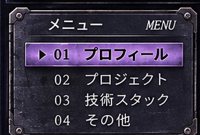</a><a href="https://github.com/4tRitch?tab=repositories" title="Whoami">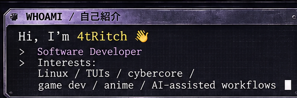</a><a href="https://github.com/4tRitch/lnx-df" title="System status">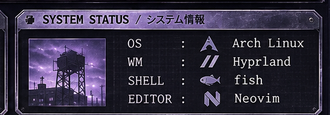</a> 
<a href="#tech-stack" title="Tech Stack">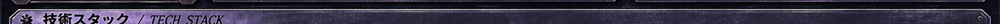</a> 
<a href="https://www.rust-lang.org/" title="Rust">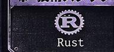</a><a href="https://learn.microsoft.com/dotnet/csharp/" title="C#">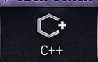</a><a href="https://www.typescriptlang.org/" title="TypeScript">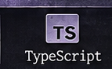</a><a href="https://svelte.dev/" title="Svelte">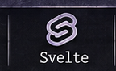</a><a href="https://go.dev/" title="Go">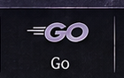</a><a href="https://www.postgresql.org/" title="PostgreSQL">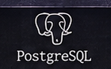</a><a href="https://www.docker.com/" title="Docker">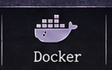</a><a href="https://archlinux.org/" title="Arch Linux">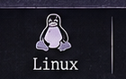</a><a href="https://git-scm.com/" title="Git">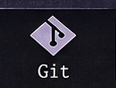</a><a href="https://github.com/4tRitch/lnx-df" title="CLI / TUI">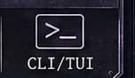</a> 
<a href="#projects" title="Featured projects">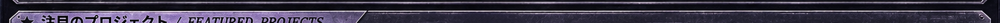</a> 
<a href="https://okaimono.dev/" title="Okaimono — anime collection tracker">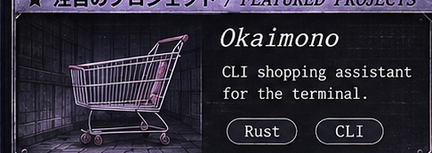</a><a href="https://github.com/4tRitch/webcore-ui" title="webcore-ui — retro Y2K UI studies">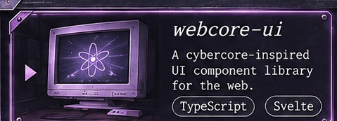</a><a href="https://github.com/4tRitch/clikity" title="Clikity — Tauri ClickUp task creator">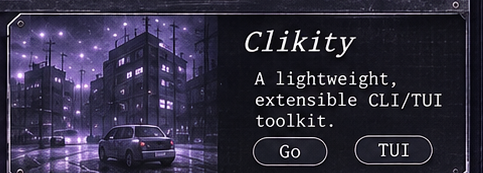</a> 
<a href="https://open.spotify.com/" title="Retro audio player illustration — music page opens externally, no playback in README">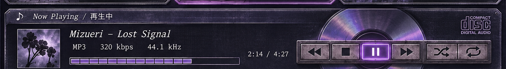</a> 
<a href="#profile" title="Back to profile">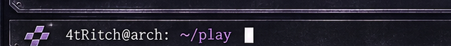</a><a href="https://github.com/4tRitch?tab=repositories" title="Explore repositories">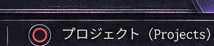</a><a href="https://x.com/Dot_Choco" title="Contact on X">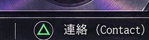</a><a href="#profile" title="Back to top">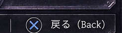</a>

Text navigation / About these projects

**4tRitch** — Software developer working with Rust, C#, TypeScript, Svelte, Go and Linux.

- **[Okaimono](https://okaimono.dev/)** — Anime collection tracker with calendar and Crew, built with Rust and Svelte.
- **[webcore-ui](https://github.com/4tRitch/webcore-ui)** — Research and static demos of retro web interfaces inspired by 2005–2008 portals.
- **[Clikity](https://github.com/4tRitch/clikity)** — Tauri and SvelteKit desktop app to create ClickUp tasks from templates.

[Projects](https://github.com/4tRitch?tab=repositories) · [Contact on X](https://x.com/Dot_Choco) · [GitHub](https://github.com/4tRitch)

*The music player is an illustration; the README cannot play audio. The art-faithful version retains some fictional placeholder captions from the original visual concept.*

