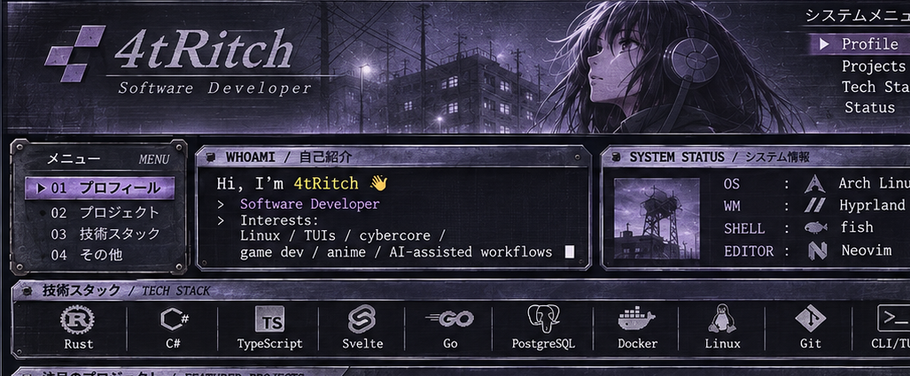
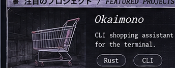
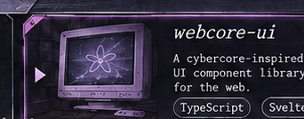
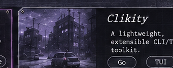
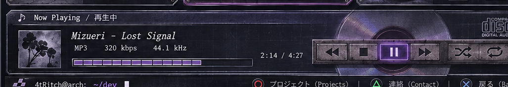

<!--
4tRitch - PS2 / CYBERCORE PROFILE
Visual assets are taken directly from the approved preview.
The menu and player are decorative; linked cards and text links are functional.
DO NOT replace these assets with the previous version's procedural recreations.
-->

  
  
  

  ◯ <a href="https://github.com/4tRitch?tab=repositories">PROJECTS</a> &nbsp; · &nbsp; △ <a href="https://okaimono.dev">OKAIMONO</a> &nbsp; · &nbsp; ✕ <a href="https://x.com/Dot_Choco">CONTACT / X</a>

<!--
IMPORTANT: The approved visual concept includes placeholder project copy.
Real project descriptions:
- Okaimono: anime collection, statuses, calendar and friends (Rust + Svelte).
- webcore-ui: educational retro UI studies and demos inspired by 2005–2008 web design.
- Clikity: Tauri + SvelteKit desktop app to create ClickUp tasks from templates.
See README-PIXEL-PERFECT.md for unsegmented 1-image version.
-->
