<!-- PS2 Cybercore | GitHub-safe README | full-height, independent, linked image modules. -->

<a href="https://github.com/4tRitch" title="4tRitch · software developer">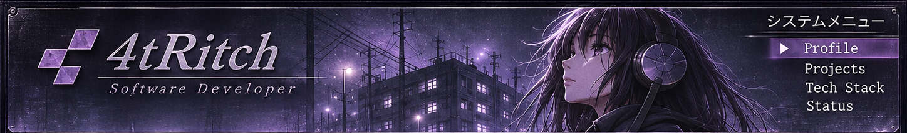</a> 
<a href="#navigation" title="Menu — see clickable navigation below">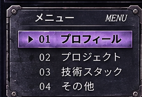</a><a href="https://github.com/4tRitch?tab=repositories" title="About 4tRitch">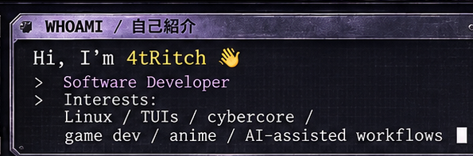</a><a href="https://github.com/4tRitch/lnx-df" title="My development environment">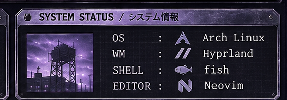</a> 
<a href="https://www.rust-lang.org/" title="Rust">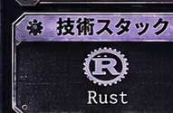</a><a href="https://learn.microsoft.com/dotnet/csharp/" title="C#">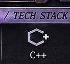</a><a href="https://www.typescriptlang.org/" title="TypeScript">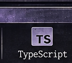</a><a href="https://svelte.dev/" title="Svelte">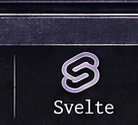</a><a href="https://go.dev/" title="Go">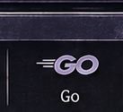</a><a href="https://www.postgresql.org/" title="PostgreSQL">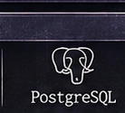</a><a href="https://www.docker.com/" title="Docker">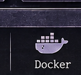</a><a href="https://archlinux.org/" title="Linux">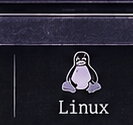</a><a href="https://git-scm.com/" title="Git">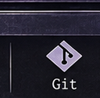</a><a href="https://github.com/4tRitch/lnx-df" title="CLI / TUI">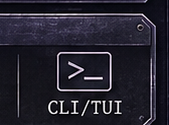</a> 
<a href="https://okaimono.dev/" title="Okaimono — anime collection manager">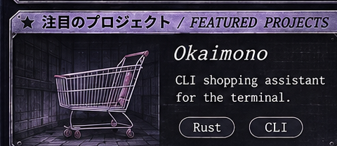</a><a href="https://github.com/4tRitch/webcore-ui" title="webcore-ui — web retro UI experiments">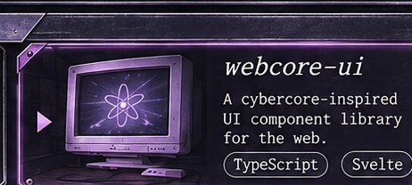</a><a href="https://github.com/4tRitch/clikity" title="Clikity — Tauri ClickUp task creation">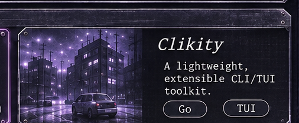</a> 
<a href="#music" title="Decorative audio player · music information below">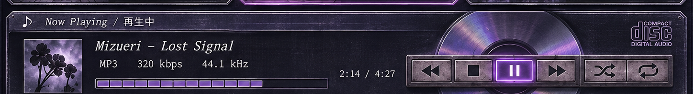</a> 
<a href="#profile" title="Back to profile">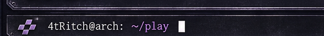</a><a href="https://github.com/4tRitch?tab=repositories" title="Projects">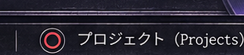</a><a href="https://x.com/Dot_Choco" title="Contact">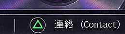</a><a href="#profile" title="Back to top">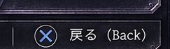</a>

SELECT ▸ Navigation / ナビゲーション

[01 PROFILE](#profile)　·　[02 PROJECTS](#projects)　·　[03 TECH STACK](#tech-stack)　·　[04 CONTACT](#contact)

PROJECT FILES ▸ Open featured projects

- [Okaimono](https://okaimono.dev/) — Anime collection manager with calendar and Crew (Rust, Svelte, PostgreSQL).
- [webcore-ui](https://github.com/4tRitch/webcore-ui) — Research and static demos of retro web portals from 2005–2008.
- [Clikity](https://github.com/4tRitch/clikity) — Desktop app for creating ClickUp tasks from templates (Tauri, SvelteKit).

TECH STACK ▸ Open technology links

[Rust](https://www.rust-lang.org/) · [C#](https://learn.microsoft.com/dotnet/csharp/) · [TypeScript](https://www.typescriptlang.org/) · [Svelte](https://svelte.dev/) · [Go](https://go.dev/) · [PostgreSQL](https://www.postgresql.org/) · [Docker](https://www.docker.com/) · [Arch Linux](https://archlinux.org/) · [Git](https://git-scm.com/) · [CLI / TUI](https://github.com/4tRitch/lnx-df)

NOW PLAYING ▸ About the player

The CD player is decorative PS2-era artwork; GitHub READMEs cannot run audio players or JavaScript.

**CONTACT**　[GitHub](https://github.com/4tRitch)　·　[X / @Dot_Choco](https://x.com/Dot_Choco)

GitHub renders HTML and Markdown, but not custom CSS, JavaScript, CSS-based image overlays or image-map hotspots. This README uses separate clickable image panels.
