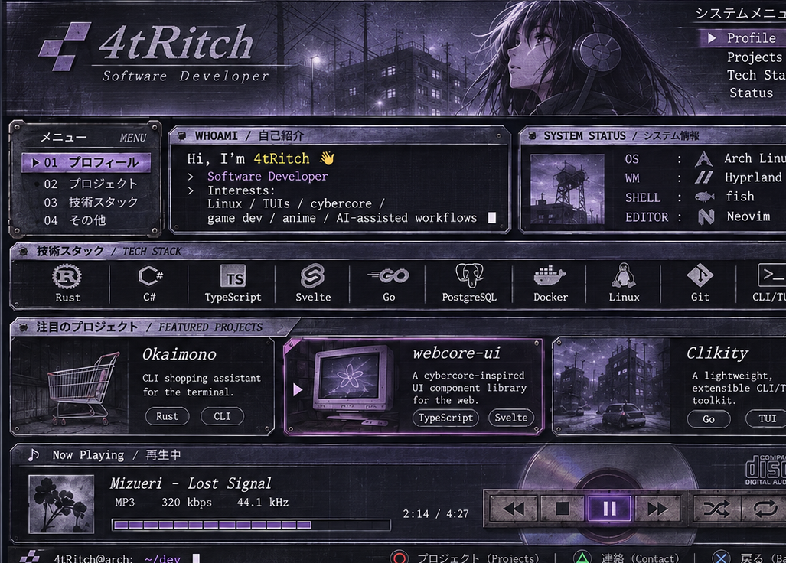

<!-- PIXEL-PERFECT alternative: one continuous image, no seams and no CSS. -->

  

  <a href="https://okaimono.dev">OKAIMONO</a>　·　<a href="https://github.com/4tRitch/webcore-ui">WEBCORE-UI</a>　·　<a href="https://github.com/4tRitch/clikity">CLIKITY</a>　·　<a href="https://x.com/Dot_Choco">CONTACT</a>

