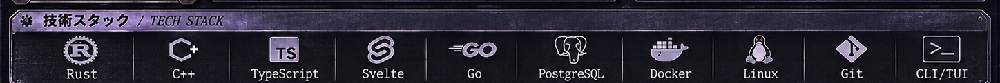
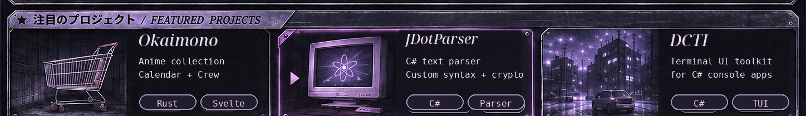
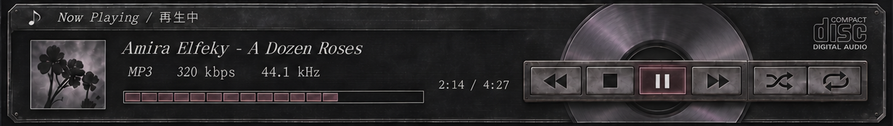
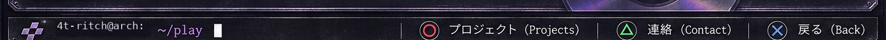

<!-- 4t-ritch // PS2 profile: complete independent panels, no chopped text or borders. -->

◉ SYSTEM MENU — navigation

[01 — Profile](#profile) · [02 — Projects](#projects) · [03 — Tech stack](#tech) · [04 — Contact](#contact)

▣ WHOAMI — details

Software developer focused on Rust, C#, TypeScript, Svelte, Linux and building useful interfaces and tools. I enjoy retro UI, anime, game development and automation.

▤ PROJECT FILES — accurate descriptions and links

- [**Okaimono**](https://okaimono.dev/) — Anime collection manager with calendar, collections and Crew. Built using Rust, Svelte and PostgreSQL.
- [**JDotParser**](https://github.com/4t-ritch/JDotParser) — C# text serializer/parser using a custom syntax and an optional cryptography layer.
- [**DCTI**](https://github.com/4t-ritch/DCTI) — Terminal user interface library for C# console applications.

▦ SYSTEM COMPONENTS — technology links

[Rust](https://www.rust-lang.org/) · [C#](https://learn.microsoft.com/dotnet/csharp/) · [TypeScript](https://www.typescriptlang.org/) · [Svelte](https://svelte.dev/) · [Go](https://go.dev/) · [PostgreSQL](https://www.postgresql.org/) · [Docker](https://www.docker.com/) · [Arch Linux](https://archlinux.org/) · [Git](https://git-scm.com/) · [CLI / TUI](https://github.com/4t-ritch/lnx-df)

♫ AUDIO — PS2 player

The CD player is artwork inspired by early-2000s music interfaces, not an actual audio player.

✉ CONTACT

[GitHub](https://github.com/4t-ritch) · [X / @Dot_Choco](https://x.com/Dot_Choco)

