<!-- 4t-ritch // PS2 profile: complete independent panels, no chopped text or borders. -->

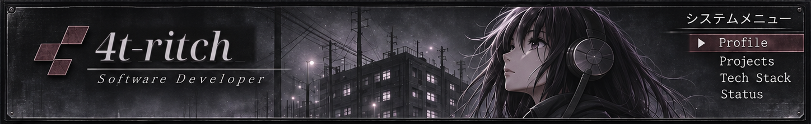

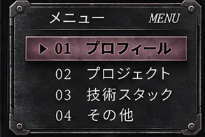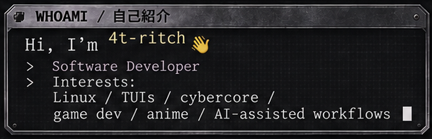<a href="https://github.com/4t-ritch/lnx-df" title="System dotfiles">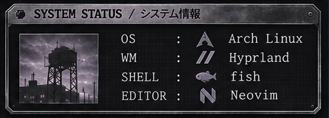</a>

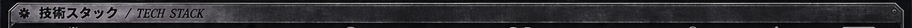

<a id="tech" href="https://www.rust-lang.org/" title="Rust">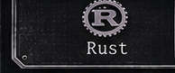</a><a href="https://isocpp.org/" title="C++">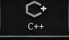</a><a href="https://www.typescriptlang.org/" title="TypeScript">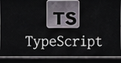</a><a href="https://svelte.dev/" title="Svelte">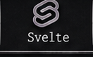</a><a href="https://go.dev/" title="Go">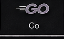</a><a href="https://www.postgresql.org/" title="PostgreSQL">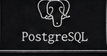</a><a href="https://www.docker.com/" title="Docker">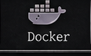</a><a href="https://archlinux.org/" title="Linux / Arch Linux">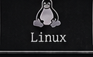</a><a href="https://git-scm.com/" title="Git">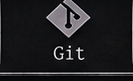</a><a href="https://github.com/4t-ritch/lnx-df" title="CLI / TUI">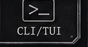</a>

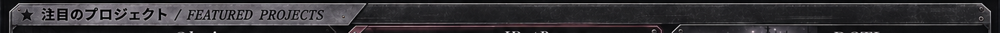

<a id="projects" href="https://okaimono.dev/" title="Okaimono">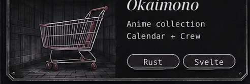</a><a href="https://github.com/4t-ritch/JDotParser" title="JDotParser">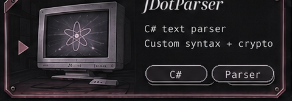</a><a href="https://github.com/4t-ritch/DCTI" title="DCTI">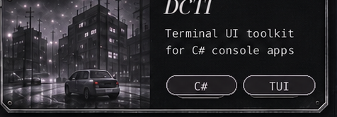</a>

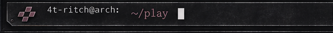<a href="#projects" title="Projects">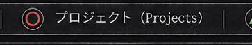</a><a id="contact" href="https://x.com/4t_ritch" title="X / @4t_ritch">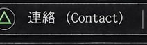</a><a href="#top" title="Back to top">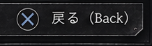</a>

