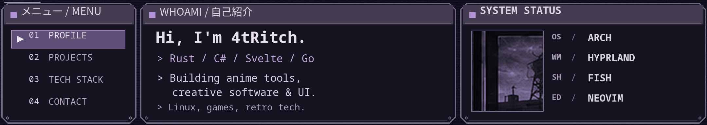
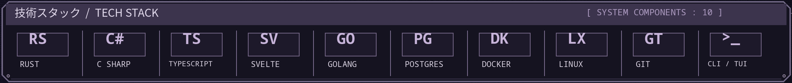
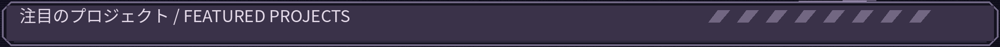
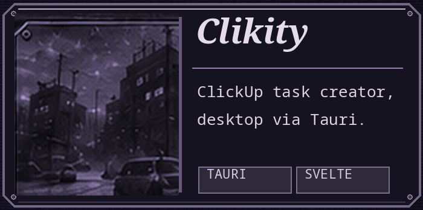
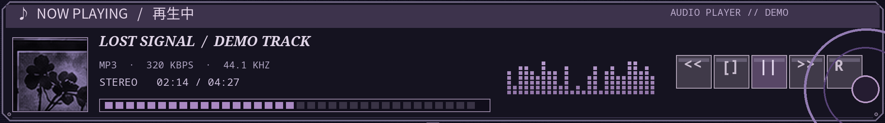

<!--
  4tRitch / PS2 ARCHIVE — GitHub Profile README
  All graphics are local PNG files in ./assets.
  The menu and audio player are visual (static); project cards and links below are real hyperlinks.
-->

  
  
  
  
  
  
  
  
  

  
    <a href="https://github.com/4tRitch">GITHUB</a>
    &nbsp; · &nbsp;
    <a href="https://okaimono.dev">OKAIMONO</a>
    &nbsp; · &nbsp;
    <a href="https://github.com/4tRitch?tab=repositories">REPOSITORIES</a>
    &nbsp; · &nbsp;
    <a href="https://x.com/Dot_Choco">X / TWITTER</a>
  

